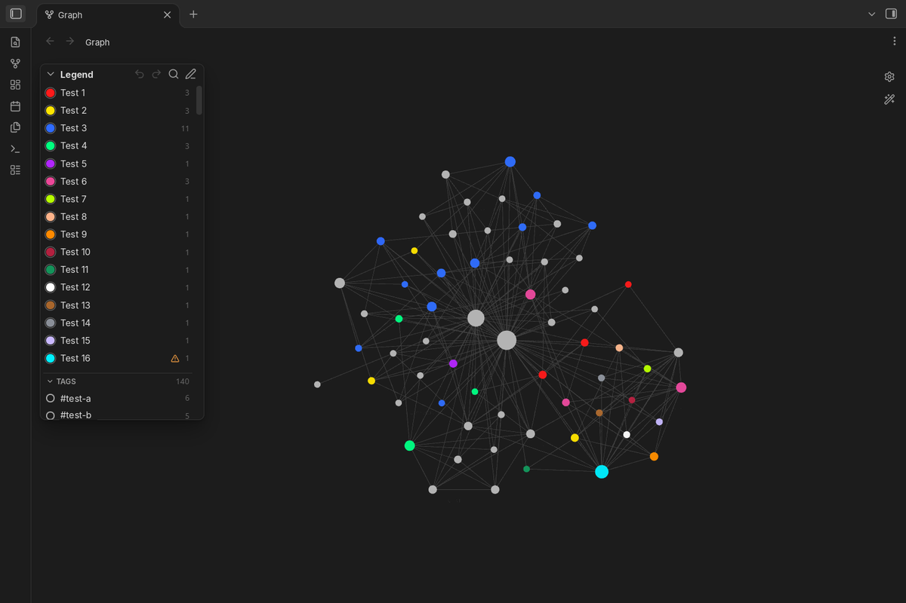
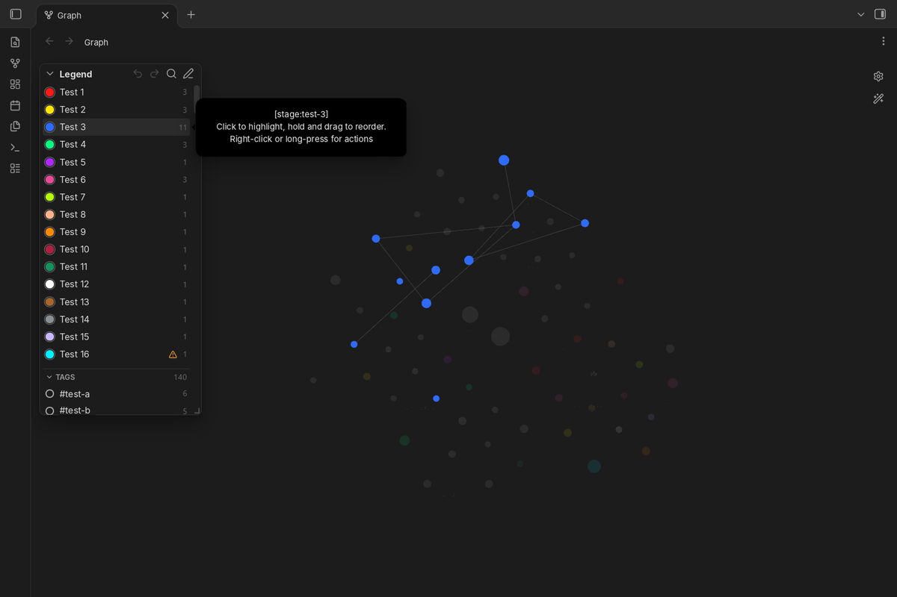
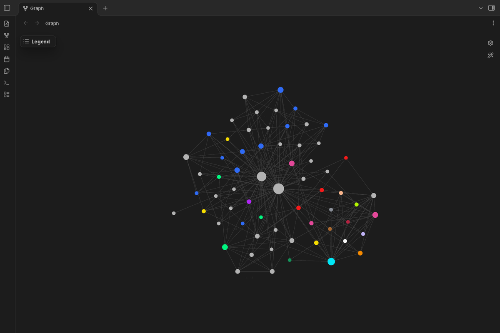

# Graph Color Legend

Shows the color groups of the Obsidian graph view as a small legend in the corner of the graph, so you can see at a glance what each color means.







[Русская версия ниже](#graph-color-legend-по-русски)

## Features

- **Legend on the graph.** Every color group from the graph settings (Groups) is listed with its color. Works in the global graph and in the local graph.
- **Tags and properties.** Below the color groups, two collapsible sections list the tags and the property values (for example `stage: idea`) of the notes that the graph shows, with the number of notes. They can be highlighted like groups; the notes keep their own colors. Both sections can be turned off in the settings.
- **Collapsible and resizable.** Collapse the legend to a small button; the state is remembered. Drag the free edge or corner of the legend to make it wider or taller (double-click the edge to go back to the automatic size). The size is kept separately for the global and the local graph; long lists scroll.
- **Search.** The magnifier next to the pencil opens a search box that filters all entries by name or query as you type. The cross inside the box clears it, the cross next to it (or Esc) closes it; pressing the magnifier again selects the text so you can type a new search.
- **Readable names.** A name is taken, in this order, from: the name you gave it in the legend; a note that describes the entry with the property `graph-legend: "<query>"` (the note's title is used, and the menu gets “Open page”); or the query itself (`[stage:idea]` becomes `stage: idea`, `tag:#tools tag:#voice` becomes `#tools #voice`).
- **Menu and edit mode.** Right-click an entry (long-press on phones) for its menu: highlight it, open its page, rename it only in the legend, rename the tag everywhere, or hide it. In edit mode (the pencil button in the legend header) each entry has an eye button with three states: grey — shown, blue — highlighted, crossed out — hidden. The eye in the header goes the same round for all entries at once (highlight all → hide all → show all), and the cross clears all highlights. Hidden entries come back there or in the plugin settings.
- **Rename a tag.** For entries built from tags, the menu offers two ways: a new name only in the legend, or renaming the tag itself in all notes (text and properties, nested tags included). Before anything changes you see the list of notes that will be edited and confirm it, and the rename can be undone with the arrow in the legend. The color group in the graph settings is updated to the new tag. The same window lets you change the group's color; it is saved in the graph settings, so the graph and the legend always show the same color.
- **Highlight.** Point at an entry and the other nodes fade. Click it to keep it highlighted, click again to turn it off; several entries can be highlighted at once. Highlights reset when Obsidian restarts.
- **Only highlighted.** With something highlighted, the target button in the header hides all other nodes instead of fading them. A bar under the header says that the mode is on and has a “Show all” button; the target button (also in the collapsed legend) and a command turn it off too.
- **Linked notes.** Optionally, highlighting an entry also keeps the notes linked to it bright (setting or command).
- **Counts and warnings.** Each color group shows how many nodes the graph draws in its color. A note gets the color of the first group that matches it, so a group can lose some or all of its notes to a group above; a warning sign then names that group. Groups that share one color are marked too, because they are highlighted together. The check understands simple queries (tags, properties, `path:`, `file:`, `-` to exclude); for other queries the legend shows only the count.
- **Drag to reorder.** Hold an entry with the mouse and move it: a see-through copy follows the pointer and the other entries make room. An entry moves only within its own section (color groups, tags or properties); outside it, or with Esc, it goes back. The order of color groups is saved in the graph settings (it decides which color a note gets); the order of tags and properties is kept by the plugin only (right-click a section title for the default order). On phones, use the grip in edit mode, since a long press opens the menu.
- **Undo and redo.** Arrows in the legend header undo and redo the legend's changes: order, new groups, sets, colors, hidden entries, names, and tag renames in notes. A tag rename is undone note by note, and only in notes that were not edited after it, so later edits are never lost. After each change a short bar under the header offers Undo right where you work. The history lasts until Obsidian restarts (up to 50 steps); renames of more than 20 MB of notes cannot be undone, and the dialog says so before you confirm.
- **Tag or property → color group.** The menu of a tag or a property has “Make a color group”: pick a color and whether the group goes first or last.
- **Show notes.** The menu of any entry lists its notes in the graph, with a filter; click a note to open it, or open the same query in Obsidian's search.
- **Sets of color groups.** In edit mode, the palette button saves the current groups (queries, colors, order) as a named set and applies saved sets, for example “by stage” and “by topic”. Applying a set can be undone. Sets are renamed or deleted in the plugin settings. A local graph has its own groups, so there a set changes only that graph.
- **Commands.** Undo and redo, show or hide the legend, search the legend, clear all highlights, show only highlighted nodes, highlight linked notes, apply a set. No hotkeys are set by default; add your own in Settings → Hotkeys.
- **Desktop and mobile.** No Node.js or Electron APIs. Touch targets are larger on phones.
- **Follows your theme.** Uses Obsidian's CSS variables.
- **Your language.** The plugin's menus follow the Obsidian interface language: English, Chinese (Simplified and Traditional), French, German, Italian, Japanese, Korean, Polish, Portuguese (Brazil), Russian, Spanish, Turkish and Ukrainian. Other languages fall back to English. Names and tags can be written in any script, and emoji work in tags too. Translations other than English and Russian were made without a native speaker; corrections are welcome as issues or pull requests (files in `src/locales/`).

## Settings

- Position: corner of the graph (top left by default).
- Font size and background opacity.
- Highlight on hover: on or off.
- Show in local graph: on or off. A local graph without its own color groups gets no legend.
- Show tags, show properties: on or off.
- Highlight linked notes: on or off.
- Show the legend: on or off (also a command).
- Sets of color groups: rename or delete.
- Entries: rename or hide each entry; reset all names.

## How it works and limits

Obsidian has no public API for the graph view. The plugin reads the color groups that the graph view itself shows (falling back to `.obsidian/graph.json`) and, for the highlight, lowers the opacity of the nodes outside the chosen group after the graph draws them. All of this is wrapped in checks: if a future Obsidian version changes the graph internals, the highlight switches itself off and the legend keeps working. Tested with Obsidian 1.15.0.

Groups that share exactly the same color are highlighted together, because nodes are matched by color.

Renaming a tag in notes uses Obsidian's own file API (`vault.process`, `fileManager.processFrontMatter`). Tags inside code blocks are not touched. A note is only edited if the tag is still exactly where Obsidian's index says it is; otherwise the note is skipped and listed. Obsidian may rewrite a `tags` property in list form when it saves properties. The undo keeps the texts in memory until Obsidian restarts; for anything older, keep a backup or use version control.

## Privacy and security

- No network requests, no telemetry, no external code. The bundle imports nothing but the `obsidian` module.
- Reads the graph settings (`.obsidian/graph.json`), its own `data.json`, and the tags and properties of notes from Obsidian's index. Writes notes only when you confirm a tag rename, and the graph's color groups only when you rename a tag, change a group's color, create or move a group, or apply a set.
- Everything from those files is shown as plain text (no `innerHTML`); settings are type-checked when loaded, so a crafted `graph.json` or `data.json` in a shared vault cannot run code or break the interface. Query parsing is linear-time and length-capped, so a crafted query cannot freeze the app.

## Installation

From Community plugins: search for "Graph Color Legend".

Manually: copy `main.js`, `manifest.json` and `styles.css` from the latest release into `<your vault>/.obsidian/plugins/graph-color-legend/`, then enable the plugin in Settings → Community plugins.

## Development

```bash
npm install
npm run dev     # rebuild on change
npm run build   # type check and production build
npx eslint .    # lint with the official Obsidian rules
```

## Support

Found a bug or have a question? [Open an issue](https://github.com/4-Humans/graph-color-legend/issues) or write to [support@4humans.io](mailto:support@4humans.io).

## License

MIT © 2026 4 Humans

---

# Graph Color Legend (по-русски)

Показывает цветовые группы графа Obsidian небольшой легендой в углу графа, чтобы сразу было видно, что означает каждый цвет.

## Возможности

- **Легенда на графе.** Все цветовые группы из настроек графа (раздел «Группы») с их цветами. Работает в общем и в локальном графе.
- **Сворачивается и меняет размер.** Легенда сворачивается в маленькую кнопку, состояние запоминается. Свободный край или угол легенды можно потянуть мышью, чтобы сделать её шире или выше (двойной щелчок по краю возвращает автоматический размер). Размер запоминается отдельно для общего и локального графа, длинный список прокручивается.
- **Переименование тега.** Для записей из тегов меню предлагает два варианта: имя только в легенде или переименование самого тега во всех заметках (в тексте и в свойствах, с вложенными тегами). Перед изменением показывается список заметок, которые будут изменены, и нужно подтверждение; переименование можно отменить стрелкой в легенде. Цветовая группа в настройках графа переходит на новый тег. В том же окне можно поменять цвет группы: он сохраняется в настройках графа, поэтому граф и легенда всегда показывают один цвет.
- **Теги и свойства.** Под цветовыми группами два сворачиваемых раздела: теги и значения свойств (например, `stage: idea`) заметок, которые показывает граф, с числом заметок. Их можно выделять так же, как группы; заметки сохраняют свои цвета. Оба раздела отключаются в настройках.
- **Поиск.** Лупа рядом с карандашом открывает строку поиска: записи отбираются по названию или запросу прямо при вводе. Крестик внутри строки стирает текст, крестик рядом с ней (или Esc) закрывает поиск; повторное нажатие на лупу выделяет набранный текст, чтобы сразу ввести новый.
- **Понятные имена.** Имя берётся по порядку: имя, заданное в легенде; заметка, которая описывает запись свойством `graph-legend: "<запрос>"` (берётся её название, а в меню появляется «Открыть страницу»); сам запрос (`[stage:idea]` → `stage: idea`, `tag:#tools tag:#voice` → `#tools #voice`).
- **Меню и режим правки.** Правый щелчок по записи (на телефоне — долгое нажатие) открывает меню: выделить, открыть страницу, переименовать только в легенде, переименовать тег везде или скрыть. В режиме правки (кнопка с карандашом в заголовке легенды) у каждой записи есть глаз с тремя состояниями: серый — видно, синий — выделено, перечёркнутый — скрыто. Глаз в заголовке проходит тот же круг сразу для всех записей (выделить всё → скрыть всё → показать всё), а крестик снимает всё выделение. Скрытые записи возвращаются там же или в настройках плагина.
- **Выделение.** Наведите на запись, и остальные узлы побледнеют. Нажатие на запись оставляет её выделенной, повторное нажатие снимает выделение; выделить можно сразу несколько записей. После перезапуска Obsidian выделение сбрасывается.
- **Только выделенное.** Когда что-то выделено, кнопка с мишенью в заголовке скрывает все остальные узлы вместо того, чтобы делать их бледными. Под заголовком появляется полоса, что режим включён, с кнопкой «Показать всё»; выключить его можно и той же кнопкой (она видна и в свёрнутой легенде), и командой.
- **Связанные заметки.** По желанию при выделении записи остаются яркими и заметки, связанные с ней ссылками (настройка или команда).
- **Счётчики и предупреждения.** У каждой цветовой группы видно, сколько узлов граф рисует её цветом. Заметка получает цвет первой подходящей группы, поэтому часть или все заметки группы может забрать группа выше; тогда рядом появляется знак предупреждения с названием этой группы. Отмечаются и группы одного цвета: они выделяются вместе. Проверка понимает простые запросы (теги, свойства, `path:`, `file:`, `-` для исключения); для остальных легенда показывает только число.
- **Перетаскивание.** Зажмите запись мышью и тяните: за курсором едет полупрозрачная копия, остальные записи раздвигаются. Запись двигается только внутри своего раздела (цветовые группы, теги или свойства); если увести её за раздел или нажать Esc, она вернётся на место. Порядок цветовых групп сохраняется в настройках графа (от него зависит цвет заметки), порядок тегов и свойств хранит только плагин (правый щелчок по заголовку раздела возвращает порядок по умолчанию). На телефоне тяните за ручку в режиме правки: долгое нажатие открывает меню.
- **Отмена и повтор.** Стрелки в заголовке легенды отменяют и повторяют изменения легенды: порядок, новые группы, наборы, цвета, скрытие, имена и переименование тега в заметках. Переименование тега отменяется по каждой заметке и только там, где заметку не меняли после него, поэтому ваши поздние правки не пропадут. После каждого изменения под заголовком на несколько секунд появляется полоса с кнопкой «Отменить» — прямо там, где вы работаете. История хранится до перезапуска Obsidian (до 50 шагов); переименование больше чем на 20 МБ заметок отменить нельзя, и окно подтверждения предупреждает об этом заранее.
- **Тег или свойство → цветовая группа.** В меню тега или свойства есть «Сделать цветовой группой»: выберите цвет и поставьте группу первой или последней.
- **Показать заметки.** Меню любой записи показывает её заметки на графе, с фильтром; нажатие открывает заметку, а кнопка открывает тот же запрос в поиске Obsidian.
- **Наборы цветовых групп.** В режиме правки кнопка с палитрой сохраняет текущие группы (запросы, цвета, порядок) как набор с именем и применяет сохранённые наборы, например «по стадиям» и «по темам». Применение набора можно отменить. Переименовать и удалить наборы можно в настройках плагина. У локального графа свои группы, поэтому там набор меняет только этот граф.
- **Команды.** Отменить и повторить, показать или скрыть легенду, поиск по легенде, снять всё выделение, показать только выделенное, подсветка связанных заметок, применить набор. Горячие клавиши по умолчанию не заданы; их можно назначить в «Настройки → Горячие клавиши».
- **ПК и телефон.** Без Node.js и Electron. На телефоне кнопки крупнее.
- **Под тему оформления.** Цвета интерфейса берутся из темы Obsidian.
- **На вашем языке.** Меню плагина на языке интерфейса Obsidian: английский, испанский, итальянский, китайский (упрощённый и традиционный), корейский, немецкий, польский, португальский (Бразилия), русский, турецкий, украинский, французский, японский; для других языков английский. Имена и теги можно писать на любом языке, в тегах работают и эмодзи. Переводы, кроме английского и русского, сделаны без носителей языка; исправления приветствуются (файлы в `src/locales/`).

## Как устроено и ограничения

У графа Obsidian нет публичного API. Плагин читает цветовые группы, которые показывает сам граф (а если не получилось, то из `.obsidian/graph.json`), а для подсветки после отрисовки делает бледнее узлы вне выбранной группы. Всё это обёрнуто проверками: если новая версия Obsidian изменит устройство графа, подсветка отключится сама, а легенда продолжит работать. Проверено на Obsidian 1.15.0.

Группы с одинаковым цветом подсвечиваются вместе, потому что узлы находятся по цвету.

Переименование тега в заметках идёт через функции Obsidian для записи файлов. Теги в блоках кода не меняются. Заметка меняется, только если тег стоит ровно там, где его видит индекс Obsidian; иначе она пропускается и показывается в списке. Отмена хранит тексты в памяти до перезапуска Obsidian; для более давних изменений держите резервную копию.

## Приватность и безопасность

- Нет сетевых запросов, телеметрии и чужого кода. В сборке нет ничего, кроме модуля `obsidian`.
- Читает настройки графа, свой `data.json`, а также теги и свойства заметок из индекса Obsidian. Заметки меняет только после вашего подтверждения переименования тега, а цветовые группы графа — только при переименовании тега, смене цвета, создании или перестановке группы и применении набора.
- Всё из этих файлов выводится как обычный текст, настройки проверяются при загрузке, поэтому подделанный `graph.json` или `data.json` в чужом хранилище не может выполнить код или сломать интерфейс. Разбор запросов ограничен по длине и не может «подвесить» программу.

## Установка вручную

Скопируйте `main.js`, `manifest.json` и `styles.css` в `<хранилище>/.obsidian/plugins/graph-color-legend/` и включите плагин в «Настройки → Сторонние плагины».

## Поддержка

Нашли ошибку или есть вопрос? [Создайте issue](https://github.com/4-Humans/graph-color-legend/issues) или напишите на [support@4humans.io](mailto:support@4humans.io).

## Лицензия

MIT © 2026 4 Humans
