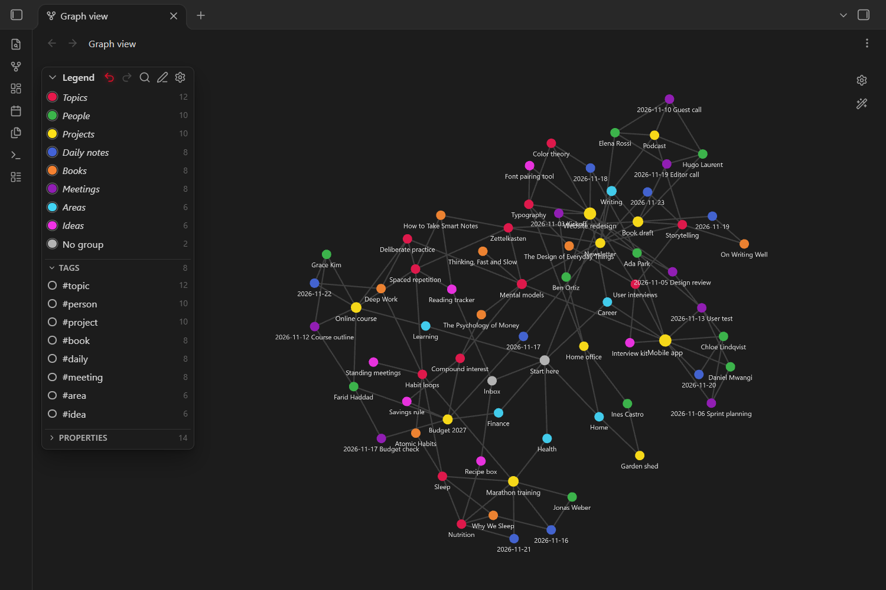
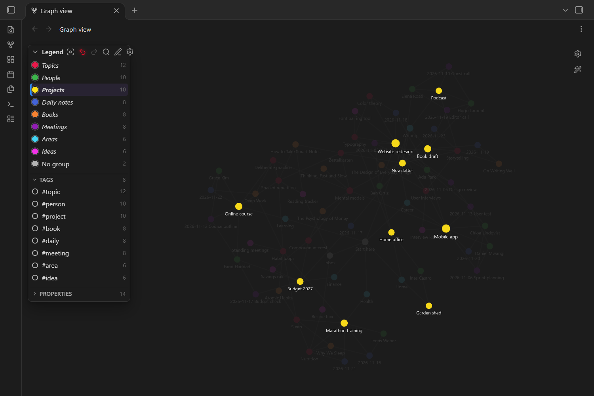

# Graph Color Legend

Your graph is a map of your notes. This is its legend and control panel.



## What it does

- Lists the graph's color groups in a small legend, with how many nodes each one colors. Works in the global and the local graph, on desktop and mobile.
- Point at an entry to highlight its notes. Click to keep it highlighted, or show only the highlighted nodes.
- Find any word from your notes on the graph: type it in the legend's search, see the matching notes light up, and open a note at the found place.
- Shows the tags and properties of the notes in the graph. Turn any of them into a color group in one step.
- Drag entries to reorder groups. A warning appears when a group above takes a group's notes.
- Rename an entry only in the legend, or rename a tag in all notes after a preview of every note that will change.
- Undo and redo every change, tag renames included.
- Put the legend in a corner or drag it by its title anywhere on the graph. Choose a roomy list or a compact view.
- Copy the legend as a picture or save it in the vault, for notes and slides.
- Search, resize and collapse the legend, save and apply sets of color groups. Follows your theme, available in 14 languages.



## Names in the legend

Added a new color group? Give it a name: rename the entry in the legend, or describe the group in a note. A group without a name shows its query in italics, and its menu offers "Give it a name".

A note describes a group with two properties:

```yaml
graph-legend: "tag:#work tag:#meeting"   # the group's query, as in the graph settings
graph-legend-name: "Meetings"            # optional short name; without it the note's title is used
```

The query is matched by meaning: `#work`, `tag:#Work` and `tag:#work` with extra spaces all find the same group. The entry's menu gets "Open page".

Each entry takes its name from the first of these that exists:

1. `graph-legend-name` in the note that describes it.
2. The name you gave it in the legend, for groups without a describing note.
3. The title of the note that describes it.
4. The query itself, made readable: `[status:done]` becomes `status: done`, `tag:#work tag:#meeting` becomes `#work #meeting`.

Renaming an entry in the legend writes to the note when the group has one, so you and your AI agent always see the same name. Otherwise the plugin keeps the name, and moves it into the note once a describing note appears.

## Vaults kept by AI agents

**The problem.** If an AI agent (Claude Code, Codex, Cursor, Gemini and others) adds color groups to your vault, the new groups show up in the legend as raw queries, for example `#work #meeting` instead of "Meetings", or `path:Journal/Daily` instead of "Daily notes". The agent does not know that the legend needs a name.

**The fix.** Add this rule to the agent's instructions file (`AGENTS.md`, `CLAUDE.md` or similar):

```
When you add a color group to .obsidian/graph.json:
1. Find or create the note that describes the group.
2. In its front matter, add: graph-legend: "<query>" (the group's query from graph.json)
3. For a short legend name, also add: graph-legend-name: "<name>"
4. Do not edit the Graph Color Legend plugin's data.json.
```

**Why a note property.** The agent already works with notes, so the rule is easy for it to follow. The name also survives sync and reinstalling the plugin, which names kept in the plugin's settings do not. And it works both ways: when you rename such a group in the legend, the new name lands in the note, where the agent reads it.

**Changes appear at once.** Obsidian reads `graph.json` only at startup, so a group the agent adds while Obsidian is open normally shows up only after a restart. The plugin looks at the file every two seconds: new, changed and reordered groups go to the graph at once, with a short note in the legend and **Undo**.

**Removed groups wait for you.** A group that disappears from the file is not taken off the graph by itself, because an agent can delete one by mistake and nobody would notice. A window opens in the middle of the screen (when a graph is open and you are not typing) and lists those groups with their colors and names. Each has a switch, on by default: **Keep checked** puts the checked groups back into the file, **Remove all** removes them. Closing the window decides nothing: the legend shows a bar with **Review**, and the window comes back the next time Obsidian starts. Groups removed while Obsidian was closed are found at startup the same way. A group that keeps its place and color but gets a new query (a renamed tag) counts as edited, not removed.

## Privacy

Everything runs inside Obsidian on your device. The plugin makes no network requests, sends nothing anywhere, collects no statistics and keeps no data outside your vault.

It reads `.obsidian/graph.json` every two seconds to show changes made outside Obsidian, and writes to it only the color groups: when you reorder or edit groups, restore them, or keep groups that were removed outside Obsidian. Filters, forces and other graph settings in the file are left as they are.

While the search box is open, it reads the text of your notes to find what you type. The text stays in memory on your device and is dropped when you close the search.

Apart from the search, it reads the list of notes only for two features: renaming a tag in all notes, and taking entry names from notes with the `graph-legend` property. It writes to notes only for these too: a tag rename after you confirm it, and the `graph-legend-name` of a note that describes a group you renamed. Changes can be undone with the arrow in the legend.

Details: everything read from files is shown as plain text, settings are checked when loaded, and query parsing is length-capped, so a crafted `graph.json` or `data.json` in a shared vault cannot run code or freeze the app. The bundle imports nothing but the `obsidian` module.

<details>
<summary>All features in detail</summary>

- **Legend on the graph.** Every color group from the graph settings (Groups) is listed with its color. Works in the global graph and in the local graph. Groups with no notes in the graph are left out (a setting).
- **Tags and properties.** Below the color groups, two collapsible sections list the tags and the property values (for example `status: done`) of the notes that the graph shows, with the number of notes. They can be highlighted like groups; the notes keep their own colors. Both sections can be turned off in the settings.
- **Anywhere on the graph.** Drag the legend by its title to any place on the graph; a short click on the title still collapses it. The place is kept separately for the global and the local graph and stays inside the graph when the window gets smaller. Right-click the header and choose “Back to the corner” to return it.
- **List or compact.** Two styles: a roomy list, or compact rows for many groups and small screens. Switch in the settings, in the header’s right-click menu or with a command.
- **Legend as a picture.** The header’s right-click menu, the picture button in edit mode and two commands copy the color groups as a PNG or save it where the vault keeps attachments. The picture is drawn in your theme’s colors, without buttons. Where the clipboard cannot take pictures (some phones), it is saved instead.
- **Collapsible and resizable.** Collapse the legend to a small button; the state is remembered. Drag the free edge or corner of the legend to make it wider or taller (double-click the edge to go back to the automatic size). The size is kept separately for the global and the local graph; long lists scroll.
- **Search.** The magnifier next to the pencil opens a search box that filters all entries by name or query as you type. The cross inside the box clears it, the cross next to it (or Esc) closes it; pressing the magnifier again selects the text so you can type a new search.
- **Readable names.** A name is taken, in this order, from: `graph-legend-name` in a note that describes the entry with `graph-legend: "<query>"`; the name you gave it in the legend; that note's title (the menu then gets “Open page”); or the query itself (`[status:done]` becomes `status: done`, `tag:#work tag:#meeting` becomes `#work #meeting`). Renaming in the legend writes to the describing note when there is one. Unnamed color groups are shown in italics.
- **Menu and edit mode.** Right-click an entry (long-press on phones) for its menu: highlight it, open its page, rename it only in the legend, rename the tag everywhere, or hide it. In edit mode (the pencil button in the legend header) each entry has an eye button with three states: grey — shown, blue — highlighted, crossed out — hidden. The eye in the header goes the same round for all entries at once (highlight all → hide all → show all), and the cross clears all highlights. Hidden entries come back there or in the plugin settings.
- **Rename a tag.** For entries built from tags, the menu offers two ways: a new name only in the legend, or renaming the tag itself in all notes (text and properties, nested tags included, and the `graph-legend` queries of describing notes). Before anything changes you see the list of notes that will be edited and confirm it, and the rename can be undone with the arrow in the legend. The color group in the graph settings is updated to the new tag. The same window lets you change the group's color; it is saved in the graph settings, so the graph and the legend always show the same color.
- **Highlight.** Point at an entry and the other nodes fade. Click it to keep it highlighted, click again to turn it off; several entries can be highlighted at once. Highlights reset when Obsidian restarts.
- **Only highlighted.** With something highlighted, the target button in the header hides all other nodes instead of fading them. A bar under the header says that the mode is on and has a “Show all” button; the target button (also in the collapsed legend) and a command turn it off too.
- **Linked notes.** Optionally, highlighting an entry also keeps the notes linked to it bright (setting or command).
- **Counts and warnings.** Each color group shows how many nodes the graph draws in its color. A note gets the color of the first group that matches it, so a group can lose some or all of its notes to a group above; a warning sign then names that group. Groups that share one color are marked too, because they are highlighted together. The check understands simple queries (tags, properties, `path:`, `file:`, `-` to exclude); for other queries the legend shows only the count.
- **Drag to reorder.** Hold an entry with the mouse and move it: a see-through copy follows the pointer and the other entries make room. An entry moves only within its own section (color groups, tags or properties); outside it, or with Esc, it goes back. The order of color groups is saved in the graph settings (it decides which color a note gets); the order of tags and properties is kept by the plugin only (right-click a section title for the default order). On phones, use the grip in edit mode, since a long press opens the menu.
- **Undo and redo.** Arrows in the legend header undo and redo the legend's changes: order, new groups, sets, colors, hidden entries, names, and tag renames in notes. A tag rename is undone note by note, and only in notes that were not edited after it, so later edits are never lost. After each change a short bar under the header offers Undo right where you work. The history lasts until Obsidian restarts (up to 50 steps); renames of more than 20 MB of notes cannot be undone, and the dialog says so before you confirm.
- **Tag or property → color group.** The menu of a tag or a property has “Make a color group”: pick a color and whether the group goes first or last.
- **Show notes.** The menu of any entry lists its notes in the graph, with a filter; click a note to open it, or open the same query in Obsidian's search.
- **Sets of color groups.** In edit mode, the palette button saves the current groups (queries, colors, order) as a named set and applies saved sets, for example “by status” and “by topic”. Applying a set can be undone. Sets are renamed or deleted in the plugin settings. A local graph has its own groups, so there a set changes only that graph.
- **Commands.** Undo and redo, show or hide the legend, search the legend and notes, clear all highlights, show only highlighted nodes, highlight linked notes, apply a set, switch the compact style, copy or save the legend as a picture. No hotkeys are set by default; add your own in Settings → Hotkeys.
- **Desktop and mobile.** No Node.js or Electron APIs. Touch targets are larger on phones.
- **Follows your theme.** Uses Obsidian's CSS variables.
- **Your language.** The plugin's menus follow the Obsidian interface language: English, Chinese (Simplified and Traditional), French, German, Italian, Japanese, Korean, Polish, Portuguese (Brazil), Russian, Spanish, Turkish and Ukrainian. Other languages fall back to English. Names and tags can be written in any script, and emoji work in tags too. Translations other than English and Russian were made without a native speaker; corrections are welcome as issues or pull requests (files in `src/locales/`).

</details>

<details>
<summary>Settings</summary>

- Position: a corner of the graph (top left by default) or anywhere, by dragging the title.
- Style: list or compact.
- Font size and background opacity.
- Highlight on hover: on or off.
- Show in local graph: on or off. A local graph without its own color groups gets no legend.
- Hide empty groups: on by default. A color group with no notes in this graph is left out of the legend, also when groups above take all its notes (a catch-all group kept last). Edit mode, with the warning, and search still show empty groups. Turn it off to see every color, for example in a local graph.
- Show notes without a group: on by default. A last row for the nodes that no color group colors (grey on the graph).
- Show tags, show properties: on or off.
- Highlight linked notes: on or off.
- Search in note text: on by default. The legend's search also looks in the text of your notes. Turn it off for a very large vault or a slow phone.
- Show the legend: on or off (also a command).
- Sets of color groups: rename or delete.
- Entries: rename or hide each entry; reset all names kept by the plugin (names in notes stay).

The gear button in the legend header (or its right-click menu) opens these settings.

</details>

<details>
<summary>If the color groups disappear</summary>

The color groups belong to Obsidian's graph (Settings of the graph view, Groups), not to this plugin. The graph's **Restore default settings** button clears all of them at once, and the legend then has nothing to list. The plugin keeps a copy of the global graph's groups (queries and colors, in its own `data.json`). When all groups are gone, the legend shows a bar with **Restore**; one click puts them back, and the step can be undone with the red arrow. **Not needed** deletes the copy, for when you removed the groups on purpose. The copy follows every change of the groups, so it always holds the last non-empty set. It covers only the color groups: other graph settings reset by that button (filters, forces, display) are not restored. For those, and for a second line of defense, save the groups as a set (palette button in edit mode).

</details>

<details>
<summary>How it works and limits</summary>

Obsidian has no public API for the graph view. The plugin reads the color groups that the graph view itself shows (falling back to `.obsidian/graph.json`) and, for the highlight, lowers the opacity of the nodes outside the chosen group after the graph draws them. All of this is wrapped in checks: if a future Obsidian version changes the graph internals, the highlight switches itself off and the legend keeps working. Tested with Obsidian 1.15.0.

Groups that share exactly the same color are highlighted together, because nodes are matched by color.

Renaming a tag in notes uses Obsidian's own file API (`vault.process`, `fileManager.processFrontMatter`). Tags inside code blocks are not touched. A note is only edited if the tag is still exactly where Obsidian's index says it is; otherwise the note is skipped and listed. Obsidian may rewrite a `tags` property in list form when it saves properties. The undo keeps the texts in memory until Obsidian restarts; for anything older, keep a backup or use version control.

</details>

## Installation

From Community plugins: search for "Graph Color Legend".

Manually: copy `main.js`, `manifest.json` and `styles.css` from the latest release into `<your vault>/.obsidian/plugins/graph-color-legend/`, then enable the plugin in Settings → Community plugins.

## Development

```bash
npm install
npm run dev     # rebuild on change
npm run build   # type check and production build
npx eslint .    # lint with the official Obsidian rules
```

Releases are built and signed by GitHub Actions; see [CONTRIBUTING.md](CONTRIBUTING.md) for how to help with code or translations. See the [changelog](CHANGELOG.md) for what changed in each version.

## Support

Found a bug or have a question? [Open an issue](https://github.com/4-Humans/graph-color-legend/issues) or write to [support@4humans.io](mailto:support@4humans.io).

If the plugin helps you, a star on GitHub helps other people find it.

## License

MIT © 2026 4 Humans

---
